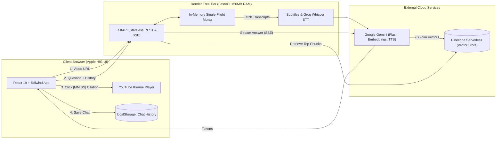

# 🎬 YouTube QnA — Apple Fluid Intelligence

A full-stack, production-grade video conversational intelligence application. Built with a decoupled **FastAPI** backend and an **Apple Design Language** frontend, optimized to run within the free tier of **Render** with cloud vector caching on **Pinecone Serverless**.

---

## ✨ Features

- **🍏 Apple Human Interface Design:**
  - Dark pitch aesthetic with frosted Liquid Glass materials (`backdrop-filter: blur(24px)`).
  - Native Apple system typography (SF Pro Text / Display).
  - Instant `:active` direct-response feedback (`scale(0.97)` on pointer-down) with spring physics.
- **⏱️ Synchronized Interactive Video Player:**
  - Embedded YouTube IFrame player that scrubs to the exact second whenever you click any `[MM:SS]` citation pill in the chat or summary.
- **⚡ Real-Time Streaming SSE Chat:**
  - Token-by-token generation using Google Gemini 2.5 Flash.
  - Conversational history persisted privately in client browser `localStorage`.
- **🎙️ Executive Voice Summary & Audio Player:**
  - Hierarchical map-reduce summarization with an Apple Podcasts-style floating player powered by Gemini TTS with playback speed toggles (`1x`, `1.25x`, `1.5x`, `2x`).
- **🛡️ Concurrency & Single-Flight Mutex:**
  - Built-in `asyncio` task lock coordinating simultaneous hits on the same video without API rate-limit exhaustion.
- **🌲 Pinecone Serverless Universal Cache:**
  - Fast vector search partitioned by `namespace=video_id` using 768-dimensional Matryoshka embeddings. Once a video is processed, it is cached for all users.
- **☁️ Render Free-Tier Optimized:**
  - Backend memory footprint `<50MB` RAM (safely within Render's 512MB cap).
  - Ephemeral disk-safe architecture.

---

## 🏛️ System Architecture



---

## 📁 Repository Structure

```
YT-QnA/
├── backend/                       # Python Backend (FastAPI)
│   ├── api/                       # REST endpoints, services, RAG engine
│   │   ├── server.py              # FastAPI application & routes
│   │   ├── services.py            # Video ingestion & single-flight lock
│   │   └── chat_service.py        # Conversational RAG & SSE streaming
│   ├── DataBases/                 # Vector Store abstractions
│   │   └── PineconeStore.py       # Pinecone serverless store (namespace=video_id)
│   ├── utils/                     # Transcription, Gemini LLM, Summarizer
│   ├── tests/                     # 19 automated unit & integration tests
│   ├── requirements.txt           # Python dependencies
│   ├── Dockerfile                 # Container definition
│   ├── streamlit_app.py           # Legacy Streamlit app (preserved)
│   └── .env.example
├── frontend/                      # Modern Apple HIG UI (React 19 + TypeScript + Vite)
│   ├── src/
│   │   ├── components/            # Navbar, YouTubePlayer, ChatView, AudioPlayer, SummaryView
│   │   ├── App.tsx                # Master state, SSE streaming, localStorage sync
│   │   ├── index.css              # Apple Liquid Glass & spring transitions
│   │   └── types.ts               # TypeScript schemas
│   ├── package.json
│   └── vite.config.ts
├── render.yaml                    # Render Blueprint (Backend Web Service + Static Site)
├── plan.md                        # Architecture & Implementation Blueprint
└── README.md
```

---

## 🚀 Quickstart (Running Locally)

### Prerequisites
- **Python 3.11+**
- **Node.js 18+** & npm
- API Keys:
  - **Google Gemini API Key:** [Google AI Studio](https://aistudio.google.com/apikey)
  - **Pinecone API Key:** [Pinecone Console](https://app.pinecone.io/) (Free Starter tier, `us-east-1`)
  - **Groq API Key (Optional fallback):** [Groq Console](https://console.groq.com/keys)

---

### 1. Setup Backend

```bash
# Navigate to backend directory
cd backend

# Create and activate virtual environment
python3 -m venv .venv
source .venv/bin/activate

# Install dependencies
pip install -r requirements.txt

# Configure environment variables
cp .env.example .env
```

Edit `backend/.env` with your keys:
```env
GEMINI_API_KEY=your_gemini_key_here
PINECONE_API_KEY=your_pinecone_key_here
PINECONE_INDEX_NAME=yt-qna
GROQ_API_KEY=your_groq_key_here
```

Run tests to verify everything is wired correctly:
```bash
python -m unittest discover tests
```

Start the FastAPI backend server:
```bash
uvicorn api.server:app --reload --port 8000
```
Backend API docs available at: `http://localhost:8000/docs`

---

### 2. Setup Frontend

Open a new terminal window:

```bash
# Navigate to frontend directory
cd frontend

# Install packages
npm install

# Start Vite development server
npm run dev
```

Open `http://localhost:5173` in your browser. The Vite dev server automatically proxies API requests to `http://localhost:8000`.

---

## ☁️ Deployment on Render

This repository includes a [`render.yaml`](./render.yaml) blueprint that deploys:
1. **`yt-qna-backend`** (Web Service, Free Tier, Python).
2. **`yt-qna-frontend`** (Static Site, Free Tier, Global CDN with 0-second cold starts).

### One-Click Blueprint Steps:
1. Push this repository to GitHub.
2. Go to your [Render Dashboard](https://dashboard.render.com/) and click **New > Blueprint**.
3. Connect your repository. Render will automatically parse `render.yaml`.
4. Fill in your environment variables:
   - `GEMINI_API_KEY`
   - `PINECONE_API_KEY`
   - `GROQ_API_KEY`
5. Click **Apply**. Both your backend and frontend will build and deploy automatically!

---

## 🔑 Environment Variables Reference

| Variable | Required | Description |
| :--- | :---: | :--- |
| `GEMINI_API_KEY` | **Yes** | Google Gemini API key for embeddings, chat, and audio TTS. |
| `PINECONE_API_KEY` | **Yes** | Pinecone API key for cloud vector storage. |
| `PINECONE_INDEX_NAME` | No | Name of Pinecone index (default: `yt-qna`). Auto-created if missing. |
| `PINECONE_CLOUD` | No | Cloud provider for index (default: `aws`). |
| `PINECONE_REGION` | No | Region for index (default: `us-east-1` for free tier). |
| `GROQ_API_KEY` | No | Optional Groq Whisper STT fallback for captionless videos. |

---

## 📄 License

This project is licensed under the Apache 2.0 License - see the [LICENSE](./LICENSE) file for details.
