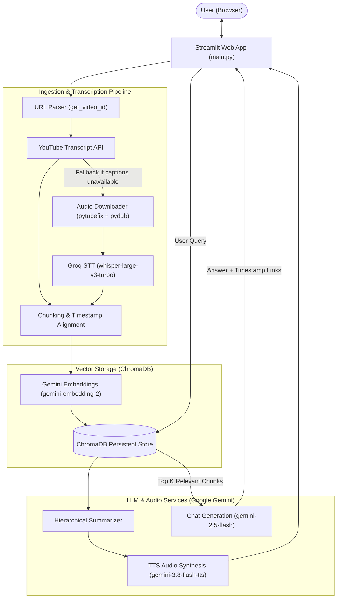
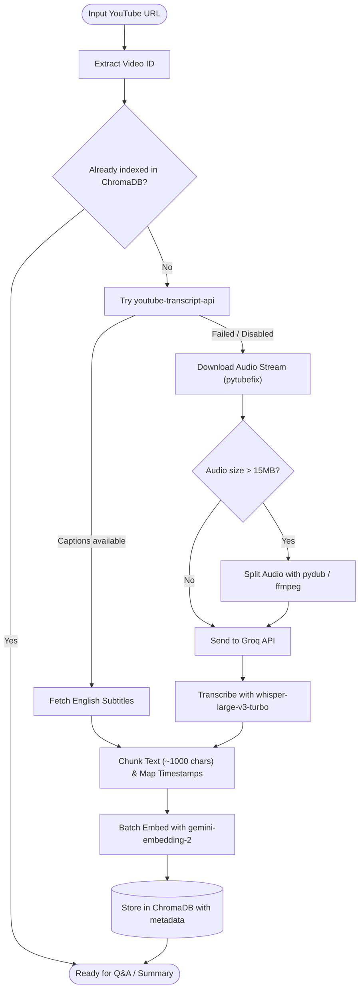
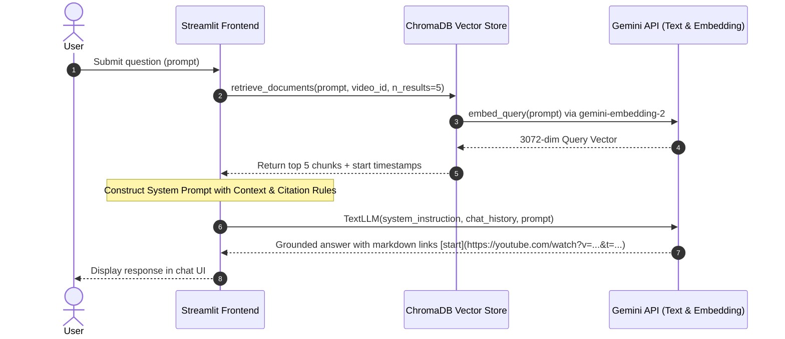
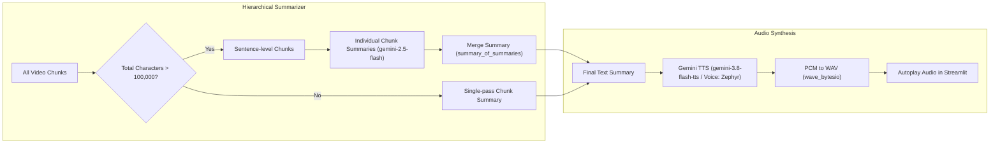

# YouTube QnA - System Architecture

This document outlines the architecture, data flow, and components of the **YouTube QnA** application.

---

## 1. High-Level Architecture Overview

---

## 2. Ingestion & Transcription Pipeline

When a user submits a YouTube URL, the application extracts the transcript through a fault-tolerant multi-tier pipeline:

---

## 3. RAG Q&A Interaction Flow

The conversational question-answering workflow uses Retrieval-Augmented Generation (RAG) to ensure grounded answers with hyperlinked timestamp citations:

---

## 4. Summarization & Voice Synthesis Flow

---

## 5. Component & Technology Matrix

| Subsystem | Components / Files | Technologies / Models | Role |
| :--- | :--- | :--- | :--- |
| **Frontend** | [main.py](file:///home/zoro/Desktop/YT-QnA/main.py) | Streamlit | Chat interface, status indicators, audio playback, sidebar configuration |
| **Transcription** | [Transcript.py](file:///home/zoro/Desktop/YT-QnA/utils/Transcript.py), [AudioDownloader.py](file:///home/zoro/Desktop/YT-QnA/utils/AudioDownloader.py) | `youtube-transcript-api`, `pytubefix`, `pydub`, `ffmpeg`, Groq (`whisper-large-v3-turbo`) | Extracts captions directly or downloads audio and transcribes via Whisper fallback |
| **Preprocessing** | [HelperFunctions.py](file:///home/zoro/Desktop/YT-QnA/utils/HelperFunctions.py) | `nltk`, `re`, `wave` | Sentence tokenization, character-bounded chunking, timestamp alignment, audio byte stream formatting |
| **Vector Database** | [VectorStore.py](file:///home/zoro/Desktop/YT-QnA/DataBases/VectorStore.py) | ChromaDB | Local persistent vector storage, metadata filtering (`youtube_id`), semantic retrieval |
| **Embeddings** | [LLM.py](file:///home/zoro/Desktop/YT-QnA/utils/LLM.py) (`GeminiLLM`) | Google Gemini (`gemini-embedding-2`) | 3072-dimensional document and query embeddings using multimodal `types.Content` architecture |
| **Summarizer** | [Summarizer.py](file:///home/zoro/Desktop/YT-QnA/utils/Summarizer.py) | Google Gemini (`gemini-2.5-flash`) | Map-reduce hierarchical summarization preserving factual content |
| **Text-to-Speech** | [LLM.py](file:///home/zoro/Desktop/YT-QnA/utils/LLM.py) (`TTS`) | Google Gemini (`gemini-3.8-flash-tts`) | Converts summaries into natural voice audio with the "Zephyr" prebuilt voice |
| **Q&A LLM** | [LLM.py](file:///home/zoro/Desktop/YT-QnA/utils/LLM.py) (`TextLLM`) | Google Gemini (`gemini-2.5-flash`) | Context-grounded multi-turn conversational chat with timestamp citation links |
