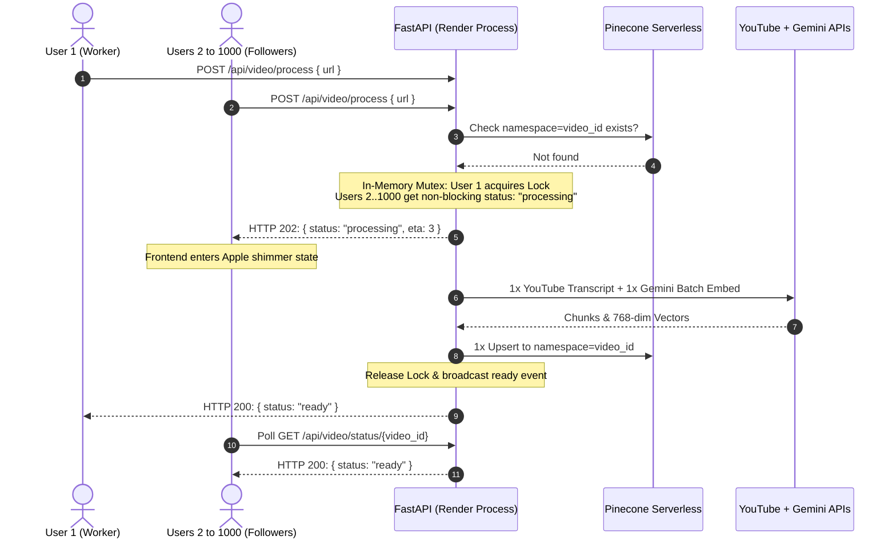
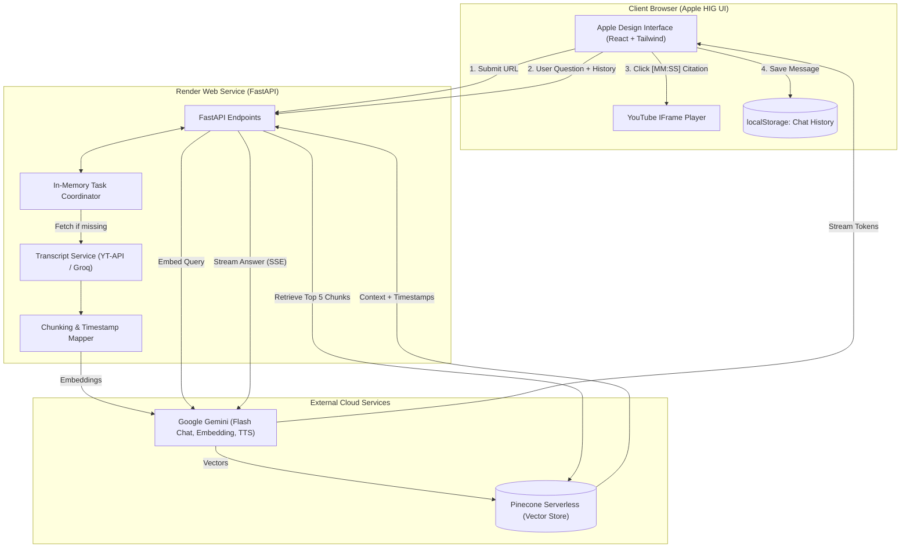

# YouTube QnA - Revised System Architecture & Implementation Plan

## 1. Executive Summary & Tech Stack

This document defines the production architecture for the YouTube QnA application, replacing the legacy Streamlit monolith with a decoupled, high-performance architecture optimized for the **Render Free Tier** and an **Apple Design Language** frontend.

| Layer | Technology | Role & Deployment |
| :--- | :--- | :--- |
| **Backend** | **FastAPI (Python 3.11+)** | Hosted on **Render Web Service (Free Tier)**. Fully asynchronous, streaming-enabled, memory-optimized (<50MB RAM). |
| **Vector Store** | **Pinecone Serverless** | Cloud vector database. Universal cache partitioned by `namespace=video_id`. Never sleeps, zero local disk dependency. |
| **AI / LLM** | **Google Gemini** | `text-embedding-004` (Embeddings), `gemini-2.5-flash` (Conversational RAG), Gemini TTS (Voice summaries). |
| **STT Fallback** | **Groq Cloud Whisper** | `whisper-large-v3-turbo` for captionless YouTube videos (sub-2s transcription without local compute). |
| **Chat Storage** | **Browser `localStorage`** | 100% private per-user conversation history. Zero database cost, zero authentication friction, persistent across sessions. |
| **Concurrency Control** | **Single-Flight In-Memory Mutex** | FastAPI native `asyncio` locking. Resolves the 1,000-user stampede on new videos without external Redis. |
| **Frontend** | **React (Vite) + Tailwind CSS + Framer Motion** | Follows Apple Human Interface Guidelines (Liquid Glass, SF Pro typography, spring physics, YouTube IFrame sync). |

---

## 2. Render Free Tier Optimization Strategy

| Render Free Constraint | Mitigation & Architecture Decision |
| :--- | :--- |
| **512 MB RAM Hard Limit** | • Offload vector storage to **Pinecone** (removes ChromaDB/SQLite binaries, saving ~200MB RAM). • Backend baseline RAM: **~35MB–50MB**. • Offload audio STT to **Groq API**; stream audio in memory or reject oversized captionless videos (>15MB). |
| **Ephemeral Local Disk** | • No local persistence required. Vectors live in Pinecone, chat lives in client browser, status lives in memory. |
| **15-Min Inactivity Spin-Down** | • Backend cold starts take ~45–50s. • Frontend stays live via CDN and displays a graceful Apple-style waking shimmer when pinging `/health`. |
| **No 15-Second Timeout** | • Unlike Vercel, Render has **no 15s execution timeout**, allowing safe processing of long videos and audio synthesis. |

---

## 3. Concurrency & Stampede Handling: Single-Flight Mutex

When a viral video is submitted by **1,000 users simultaneously**:

### Why Render Eliminates the Need for Redis:
Because Render runs a persistent single Python process (`uvicorn`), we can coordinate concurrent requests using Python's native `asyncio.Lock` and `asyncio.Event`:
- Zero extra dependencies.
- Zero extra API keys or costs.
- 100% immune to API quota exhaustion from simultaneous hits.

---

## 4. End-to-End System Workflow

---

## 5. API Specification (FastAPI on Render)

### 1. `GET /api/health`
- **Purpose:** Cold-start check and health ping for the frontend.
- **Response:** `{"status": "ok", "service": "yt-qna-backend"}`

### 2. `POST /api/video/process`
- **Body:** `{"url": "https://www.youtube.com/watch?v=..."}`
- **Response:**
  - `{"status": "ready", "video_id": "...", "title": "...", "duration": "..."}`
  - Or `{"status": "processing", "video_id": "...", "retry_after": 2}`

### 3. `GET /api/video/status/{video_id}`
- **Purpose:** Polling endpoint for concurrent users while a video is being indexed.
- **Response:** `{"status": "processing" | "ready" | "failed"}`

### 4. `POST /api/chat/stream`
- **Body:** `{"video_id": "...", "prompt": "...", "history": [...]}`
- **Response:** `text/event-stream` (Server-Sent Events streaming token by token with citation metadata).

### 5. `POST /api/video/summary`
- **Body:** `{"video_id": "..."}`
- **Response:** `{"summary": "Markdown formatted summary"}`

### 6. `POST /api/video/tts`
- **Body:** `{"text": "..."}`
- **Response:** Audio stream (`audio/wav`) using Gemini TTS.

---

## 6. Frontend Specifications (Apple Design Language)

1. **Visual Language:**
   - System typography: `-apple-system, BlinkMacSystemFont, "SF Pro Text", "SF Pro Display"`.
   - Materials: Frosted glass (`backdrop-filter: blur(20px)`), delicate borders (`rgba(255,255,255,0.1)`), and dynamic shadows.
   - Squircles: Continuous curve radii (`16px` to `24px`) on cards and containers.
2. **Motion & Interaction (Apple HIG):**
   - Instant response on pointer-down: `:active` scale down (`scale(0.97)`).
   - Springs: Critically damped (`damping: 1.0`, `response: 0.4s`) for panels; momentum-based (`damping: 0.8`, `response: 0.3s`) for gestures/drawers.
   - Streaming text: Smooth typographic reveal without layout jumps.
3. **Components:**
   - **Dynamic Top Bar:** URL input pill with paste detection and ambient status beacon.
   - **Split / Dual Layout:** Left side contains synchronized YouTube player + summary/audio player; right side contains fluid chat.
   - **Interactive Citations:** Clicking `[03:45]` smoothly scrubs the YouTube player to 225 seconds and resumes playback.
   - **Podcasts-Style Audio Player:** Floating playback bar with speed toggles (`1x`, `1.25x`, `1.5x`) and scrubber.

---

## 7. Implementation Roadmap

- [ ] **Phase 1: Backend Foundation (FastAPI + Pinecone)**
  - Configure dependencies and environment (`.env`).
  - Create Pinecone integration (`DataBases/PineconeStore.py`) replacing ChromaDB.
  - Implement the single-flight `asyncio` task lock in FastAPI (`api/services.py`).
  - Implement streaming RAG endpoint (`/api/chat/stream`) and TTS endpoint.
- [ ] **Phase 2: Render Configuration**
  - Create production `Dockerfile` / `render.yaml` optimized for Render free tier.
  - Add `/api/health` cold-start ping endpoint.
- [ ] **Phase 3: Frontend (Apple HIG React App)**
  - Initialize Vite + React + Tailwind + Framer Motion.
  - Build Apple design system components (glass cards, segmented buttons, active states).
  - Integrate YouTube IFrame Player API for bi-directional timestamp seeking.
  - Wire streaming chat with `localStorage` persistence.
